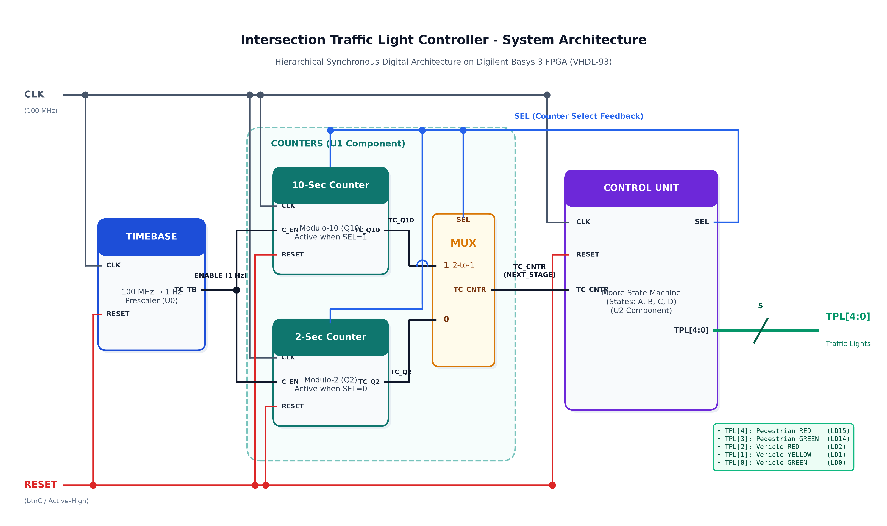
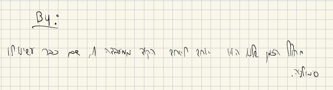
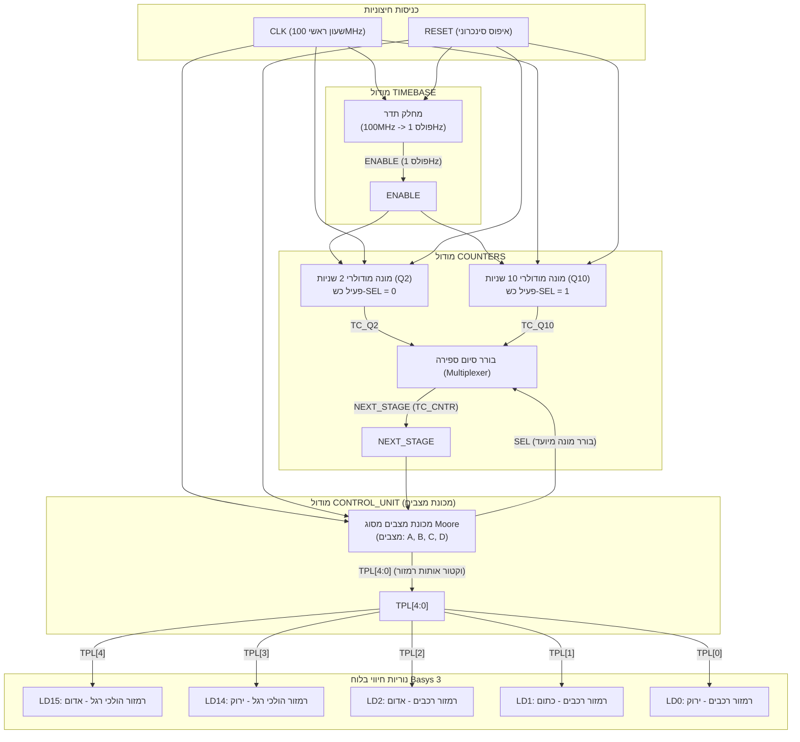
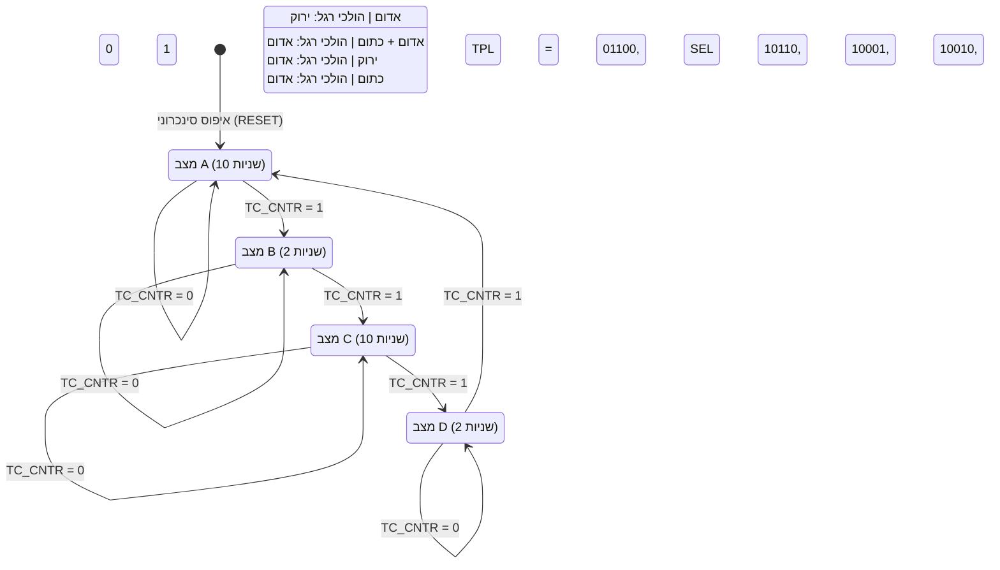
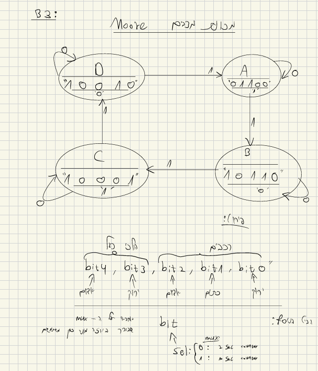
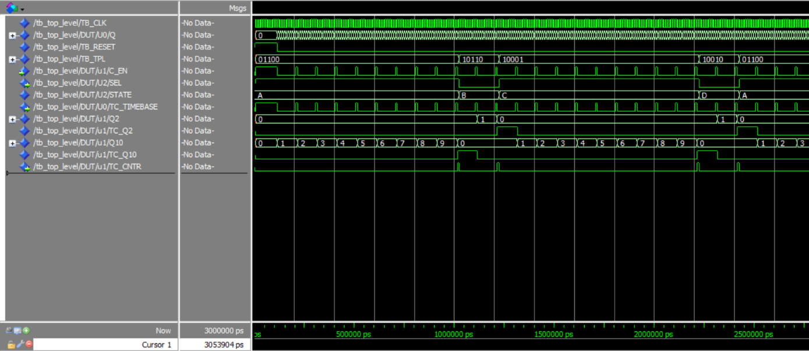
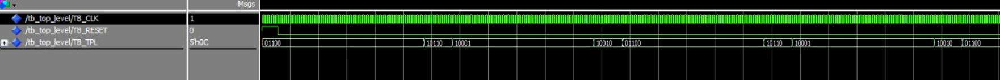
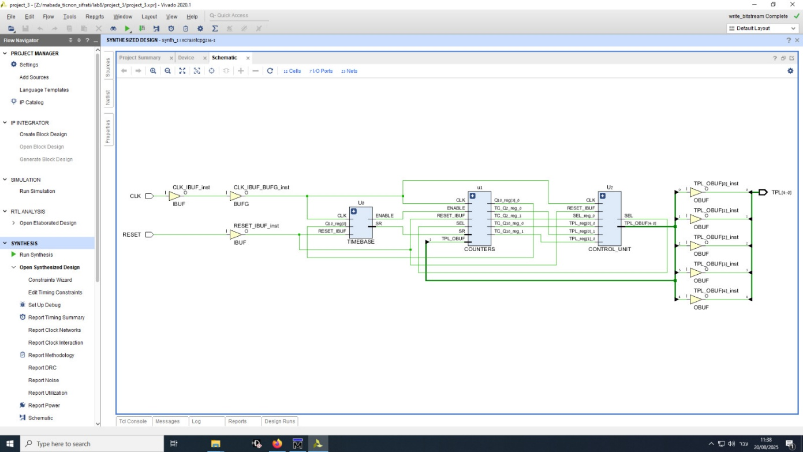
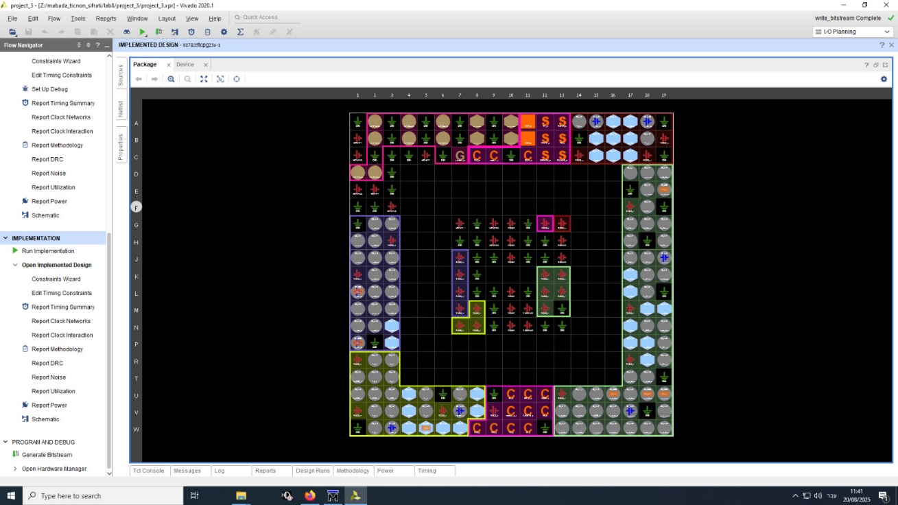

# בקר רמזור דו-כיווני על גבי FPGA Basys 3 (בשפת VHDL)

> Language / שפה: [English](README.md) • [עברית (Hebrew)](README.he.md)

[](src/)
[](constrs/basys3_master.xdc)
[](https://digilent.com/reference/programmable-logic/basys-3/start)
[](scripts/build_vivado.tcl)
[](tb/)
[](LICENSE)

<p align="center">
  
  <br>
  <em><b>מבט על של ארכיטקטורת המערכת:</b> מימוש היררכי בשפת VHDL הכולל מחלק תדר 1Hz (Timebase), מונים מודולריים מרובבים (2 ו-10 שניות), ומכונת מצבים מסוג Moore השולטת על רמזורי הרכבים והולכי הרגל.</em>
</p>

---

## 📋 תוכן עניינים
1. [סקירת הפרויקט](#-סקירת-הפרויקט)
2. [רצף מצבי הרמזור וזמני שהייה](#-רצף-מצבי-הרמזור-וזמני-שהייה)
3. [רכיבי החומרה והציוד ההיקפי](#-רכיבי-החומרה-והציוד-ההיקפי)
4. [הוראות הרצה מהירה ושכפול](#-הוראות-הרצה-מהירה-ושכפול)
5. [מבנה תיקיות הפרויקט](#-מבנה-תיקיות-הפרויקט)
6. [ארכיטקטורת המערכת ופירוט המודולים](#-ארכיטקטורת-המערכת-ופירוט-המודולים)
7. [תכן מכונת המצבים (FSM)](#-תכן-מכונת-המצבים-fsm)
8. [טבלת מיפוי פינים ואילוצים (Constraints)](#-טבלת-מיפוי-פינים-ואילוצים-constraints)
9. [סימולציה ואימות (ModelSim)](#-סימולציה-ואימות-modelsim)
10. [תוצאות סינתזה ומימוש (Vivado)](#-תוצאות-סינתזה-ומימוש-vivado)

---

## 🎯 סקירת הפרויקט

מאגר זה מכיל מימוש הנדסי מלא, מודולרי וסינתטי של **בקר רמזור לצומת דרכים** שנכתב בשפת **VHDL-93** ונצרב על כרטיס הפיתוח **Digilent Basys 3** המבוסס על רכיב ה-FPGA **Xilinx Artix-7 (XC7A35T-1CPG236C)**.

המערכת מסנכרנת ומבטיחה מעבר בטוח של כלי רכב בכביש מהיר לצד מתן זמני חצייה בטוחים להולכי רגל. התכן נבנה במבנה סינכרוני מדורג הנשען על מתנד שעון ראשי של 100MHz ומכונת מצבים מסוג Moore.

### תכונות עיקריות:
- **מחזור 4-שלבים מחזורי:** שליטה מלאה ב-5 נוריות חיווי הפועלות ב-4 פרקי זמן מוגדרים (מחזור כולל של 24 שניות).
- **הפרדה מלאה בין ערוצי רכב והולכי רגל:**
  - **רכבים:** אדום, כתום (צהוב), ירוק (`TPL[2:0]`).
  - **הולכי רגל:** אדום, ירוק (`TPL[4:3]`).
- **מחלק תדר מדויק (Timebase):** המרת תדר השעון של 100MHz לפולס Enable בקצב של 1Hz, עם תמיכה בהאצה לצורכי סימולציה.
- **מונים מודולריים מרובבים:** מעבר דינמי בין מונה 10 שניות (`Q10`) למונה 2 שניות (`Q2`) באמצעות קו בקרה בודד (`SEL`).
- **מיפוי חומרה ישיר:** נוריות הרכב ממופות לימין הלוח (`LD2..LD0`) ונוריות הולכי הרגל לשמאל הלוח (`LD15..LD14`).

---

## 🚦 רצף מצבי הרמזור וזמני שהייה

המערכת פועלת באופן מחזורי רציף ועוברת בין ארבעה מצבים מוגדרים:

| שלב / מצב | רמזור רכבים | רמזור הולכי רגל | משך השלב | קוד FSM (`STATE`) | וקטור מוצא `TPL[4:0]` | בורר מונה (`SEL`) |
| :---: | :---: | :---: | :---: | :---: | :---: | :---: |
| **שלב 1 (State A)** | 🔴 **אדום** | 🟢 **ירוק** | **10 שניות** | `A` | `01100` | `'1'` (מונה 10 שנ') |
| **שלב 2 (State B)** | 🔴 🟡 **אדום + כתום** | 🔴 **אדום** | **2 שניות** | `B` | `10110` | `'0'` (מונה 2 שנ') |
| **שלב 3 (State C)** | 🟢 **ירוק** | 🔴 **אדום** | **10 שניות** | `C` | `10001` | `'1'` (מונה 10 שנ') |
| **שלב 4 (State D)** | 🟡 **כתום** | 🔴 **אדום** | **2 שניות** | `D` | `10010` | `'0'` (מונה 2 שנ') |

<p align="center">
  
  <br>
  <em>תרשים: חלוקת הזמנים ורצף השלבים במחזור הרמזור.</em>
</p>

---

## 🛠 רכיבי החומרה והציוד ההיקפי

| רכיב | תפקיד במערכת | מאפיינים וממשק | פין בלוח |
| :--- | :--- | :--- | :---: |
| **Digilent Basys 3** | כרטיס פיתוח ראשי | רכיב Xilinx Artix-7 `XC7A35T-1CPG236C` | - |
| **מתנד פנימי 100MHz** | מקור שעון ראשי (`CLK`) | זמן מחזור 10.0ns, חובת פעימה 50% | `W5` |
| **כפתור מרכזי (`btnC`)** | איפוס סינכרוני פעיל ב-'1' (`RESET`) | איפוס וחזרה מיידית לשלב 1 (State A) | `U18` |
| **נורית LD0** | רמזור רכבים - ירוק (`TPL[0]`) | Active-High LVCMOS33 | `U16` |
| **נורית LD1** | רמזור רכבים - כתום (`TPL[1]`) | Active-High LVCMOS33 | `E19` |
| **נורית LD2** | רמזור רכבים - אדום (`TPL[2]`) | Active-High LVCMOS33 | `U19` |
| **נורית LD14** | רמזור הולכי רגל - ירוק (`TPL[3]`) | Active-High LVCMOS33 | `P1` |
| **נורית LD15** | רמזור הולכי רגל - אדום (`TPL[4]`) | Active-High LVCMOS33 | `L1` |

---

## 🚀 הוראות הרצה מהירה ושכפול

### 1. הרצת סימולציה ב-ModelSim / QuestaSim
ניתן להריץ בלחיצה אחת מתוך תיקיית הפרויקט:
```cmd
scripts\run_modelsim.bat
```
או ישירות מתוך ה-Console של ModelSim:
```tcl
cd basys3-traffic-light-controller/tb
vsim -do do.do
```

### 2. סינתזה ובניית Bitstream ב-Vivado
ניתן להריץ בנייה מלאה באצווה (Batch Mode) ללא פתיחת ממשק ה-GUI:
```shell
cd basys3-traffic-light-controller/scripts
vivado -mode batch -source build_vivado.tcl
```
קובץ ה-Bitstream יווצר בנתיב: `scripts/build_output/TOP_LEVEL.bit`.

---

## 📁 מבנה תיקיות הפרויקט

```text
basys3-traffic-light-controller/
├── LICENSE                        # רישיון קוד פתוח MIT
├── README.md                      # תיעוד הפרויקט באנגלית (English)
├── README.he.md                   # תיעוד הפרויקט בעברית (עברית)
├── .gitattributes                 # הגדרות ניהול שורות ב-Git
├── .gitignore                     # סינון קבצים זמניים של כלי הפיתוח
│
├── constrs/                       # אילוצי חומרה ומיפוי פינים
│   └── basys3_master.xdc          # קובץ XDC מפורט לכרטיס Basys 3
│
├── docs/                          # דוחות ומסמכי אפיון
│   ├── Alternative_Assessment-Traffic_Light.pdf # הוראות המטלה המקוריות
│   ├── final_report.pdf           # דוח הנדסי מסכם
│   └── assets/                    # דיאגרמות, תרשימי מצבים וסכמות
│       ├── system_architecture_block_diagram.png
│       ├── fsm_state_diagram.png
│       ├── fsm_truth_table.png
│       ├── timing_step_diagram.png
│       ├── sim_waveform_full_cycle.png
│       ├── sim_waveform_signals_zoom.png
│       ├── vivado_rtl_schematic.jpg
│       ├── vivado_device_placed.jpg
│       └── vivado_timing_utilization.jpg
│
├── reports/                       # דוחות מימוש רשמיים מ-Vivado
│   ├── TOP_LEVEL_io_placed.rpt
│   ├── TOP_LEVEL_timing_summary_routed.rpt
│   ├── TOP_LEVEL_utilization_placed.rpt
│   └── TOP_LEVEL_utilization_synth.rpt
│
├── scripts/                       # סקריפטי אוטומציה
│   ├── build_vivado.tcl           # סקריפט בנייה באצווה עבור Vivado
│   └── run_modelsim.bat           # סקריפט הרצה מהירה עבור ModelSim
│
├── src/                           # קבצי מקור סינתטיים ב-VHDL
│   ├── CONTROL_UNIT.vhd           # מכונת מצבים בת 4 מצבים (Moore FSM)
│   ├── COUNTERS.vhd               # מונים מודולריים מדורגים 2s ו-10s
│   ├── TIMEBASE.vhd               # מחלק תדר 1Hz (Clock Enable)
│   └── TOP_LEVEL.vhd              # ישות עליונה היררכית
│
└── tb/                            # סביבת בדיקה ואימות
    ├── TB_TOP_LEVEL.vhd           # Testbench ראשי לאימות המערכת
    └── do.do                      # סקריפט פקודות וצבעי גלים ל-ModelSim
```

---

## 🏗 ארכיטקטורת המערכת ופירוט המודולים

התכן בנוי בצורה היררכית וסינכרונית קפדנית:



### תפקיד המודולים:
1. **[`TOP_LEVEL.vhd`](src/TOP_LEVEL.vhd) (ישות עליונה):**
   - מחברת את שלושת תת-המודולים באמצעות Port Mapping היררכי.
   - מגדירה את החיבורים הפיזיים לפינים החיצוניים של כרטיס הפיתוח.
2. **[`TIMEBASE.vhd`](src/TIMEBASE.vhd) (מחלק תדר):**
   - דוגם את שעון ה-100MHz ומפיק דופק סיום ספירה (`ENABLE`) בקצב של 1Hz.
3. **[`COUNTERS.vhd`](src/COUNTERS.vhd) (מונים מרובבים):**
   - מכיל שני מונים סינכרוניים (מונה 2 שניות ומונה 10 שניות).
   - מנתב את אות סיום הספירה (`NEXT_STAGE`) בהתאם לערך בורר המצבים `SEL`.
4. **[`CONTROL_UNIT.vhd`](src/CONTROL_UNIT.vhd) (יחידת בקרה):**
   - מממשת מכונת מצבים בת 4 מצבים (A, B, C, D).
   - קובעת את וקטור האורות `TPL[4:0]` ואת המונה הפעיל `SEL`.

---

## 🔄 תכן מכונת המצבים (FSM)

מכונת המצבים תוכננה על פי מודל **Moore**, שבו המוצאים תלויים אך ורק במצב הנוכחי:



<p align="center">
  
  <br>
  <em>תרשים: טבלת אמת מלאה של מצבי ה-FSM והמוצאים.</em>
</p>

---

## 📌 טבלת מיפוי פינים ואילוצים (Constraints)

מוגדר בקובץ [`constrs/basys3_master.xdc`](constrs/basys3_master.xdc):

| שם פורט ב-VHDL | כיוון | פין ברכיב | תקן מתח | רכיב ב-Basys 3 | תיאור פונקציונלי |
| :--- | :---: | :---: | :---: | :--- | :--- |
| `CLK` | Input | `W5` | LVCMOS33 | מתנד ראשי 100MHz | שעון המערכת (10.0ns) |
| `RESET` | Input | `U18` | LVCMOS33 | כפתור מרכזי (`btnC`) | איפוס סינכרוני למצב A |
| `TPL[0]` | Output | `U16` | LVCMOS33 | נורית `LD0` | רמזור רכבים - ירוק |
| `TPL[1]` | Output | `E19` | LVCMOS33 | נורית `LD1` | רמזור רכבים - כתום |
| `TPL[2]` | Output | `U19` | LVCMOS33 | נורית `LD2` | רמזור רכבים - אדום |
| `TPL[3]` | Output | `P1` | LVCMOS33 | נורית `LD14` | רמזור הולכי רגל - ירוק |
| `TPL[4]` | Output | `L1` | LVCMOS33 | נורית `LD15` | רמזור הולכי רגל - אדום |

---

## 🔬 סימולציה ואימות (ModelSim)

אימות התכן בוצע בסביבת **ModelSim / QuestaSim** באמצעות ה-Testbench [`tb/TB_TOP_LEVEL.vhd`](tb/TB_TOP_LEVEL.vhd):

### אימות מחזור שלם בן 4 שלבים
אותות הסימולציה מאמתים מעבר מדויק וחלק בין ארבעת המצבים:


*תרשים: גלי סימולציה מתוך ModelSim המציגים מחזור רמזור שלם של 24 שניות.*

### פירוט אותות הבקרה
מבט מוגדל על תזמון אותות ה-`ENABLE`, `SEL`, `NEXT_STAGE` ווקטור האורות `TPL[4:0]`:


*תרשים: אימות פולסי סיום הספירה ומעבר המצבים הסינכרוני.*

---

## 📊 תוצאות סינתזה ומימוש (Vivado)

התכן עבר סינתזה ומימוש מלאים בסביבת **Xilinx Vivado 2020.1** עבור שבב ה-**XC7A35T-1CPG236C**:

### ניצולת משאבי חומרה (`TOP_LEVEL_utilization_placed.rpt`)
| סוג משאב | כמות בשימוש | זמין ברכיב | אחוז ניצולת |
| :--- | :---: | :---: | :---: |
| **Slice LUTs** | **32** | 20,800 | **0.15%** |
| **Slice Registers (FF)** | **42** | 41,600 | **0.10%** |
| **Bonded IOB** | **7** | 106 | **6.60%** |
| **Global Clock Buffers (BUFG)** | **1** | 32 | **3.13%** |
| **DSPs / Block RAM** | **0** | - | **0.00%** |

### תזמון ומימוש פיזי
- **אילוץ שעון:** 100.000 MHz (זמן מחזור מטרה 10.000 ns).
- **ניתוב והשמה:** ניתוב מושלם של כל רשתות השעון ללא נקודות קצה חופשיות.


*תרשים: סכמת RTL מפורטת שהופקה ב-Vivado.*


*תרשים: השמת הרכיבים והניתוב הפיזי על גבי ה-Artix-7.*
