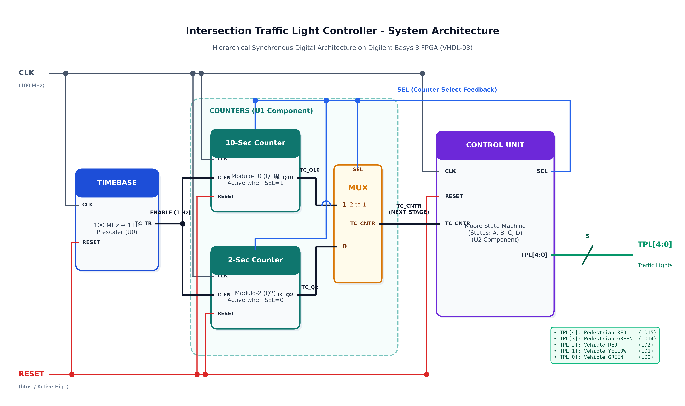
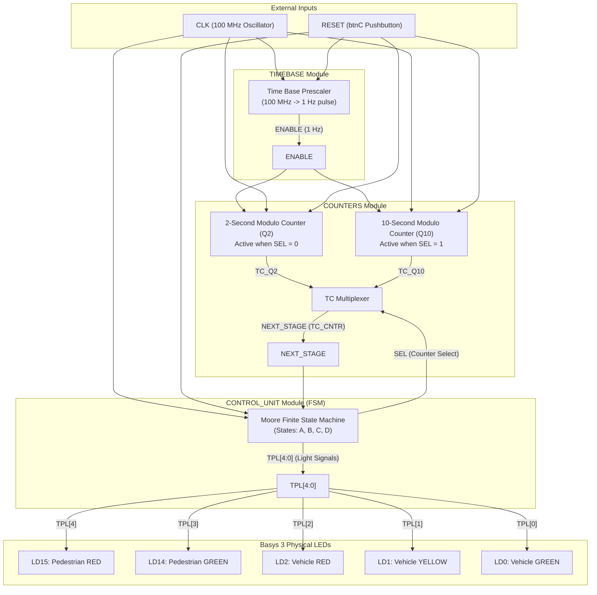
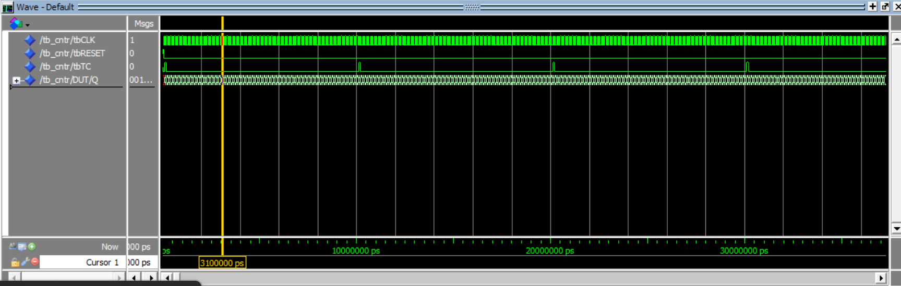
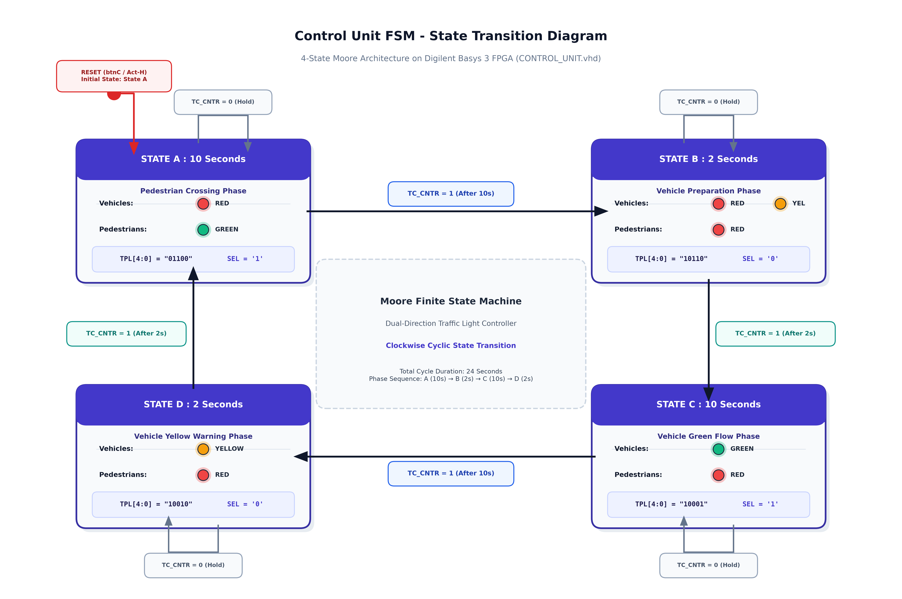
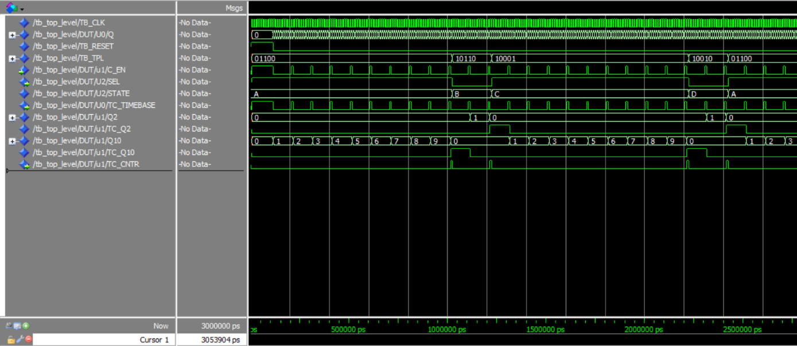
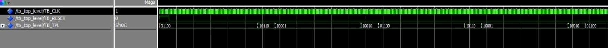
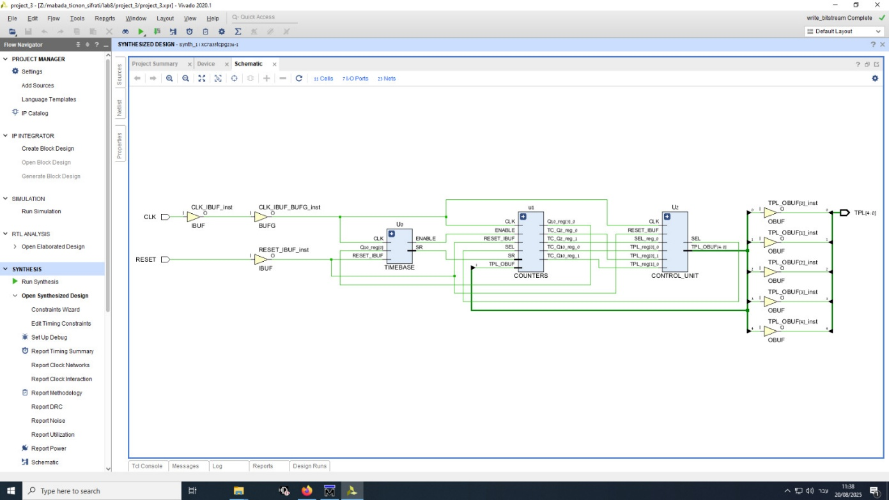
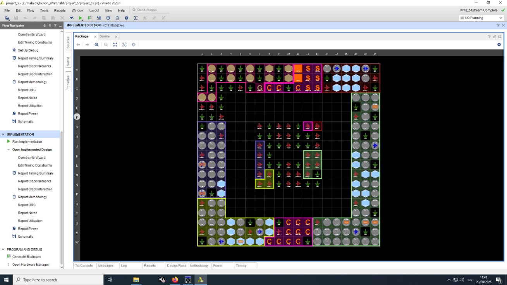

# Dual-Direction Traffic Light Controller on Basys 3 FPGA (VHDL)

> Language / שפה: [English](README.md) • [עברית (Hebrew)](README.he.md)

[](src/)
[](constrs/basys3_master.xdc)
[](https://digilent.com/reference/programmable-logic/basys-3/start)
[](scripts/build_vivado.tcl)
[](tb/)
[](LICENSE)

<p align="center">
  
  <br>
  <em><b>System Architecture Overview:</b> Hierarchical VHDL realization featuring a 1 Hz Timebase prescaler, multiplexed dual-stage Modulo Counters (2s / 10s), and a 4-state Moore Finite State Machine driving vehicle and pedestrian traffic signals.</em>
</p>

---

## 📋 Table of Contents
1. [Project Overview](#-project-overview)
2. [Traffic Light State Sequence & Timing](#-traffic-light-state-sequence--timing)
3. [Hardware & Peripheral Setup](#-hardware--peripheral-setup)
4. [Quick Start: How to Run](#-quick-start-how-to-run)
5. [Repository Directory Structure](#-repository-directory-structure)
6. [System Architecture & Submodules](#-system-architecture--submodules)
7. [Finite State Machine (FSM) Design](#-finite-state-machine-fsm-design)
8. [Pinout & FPGA Constraints](#-pinout--fpga-constraints)
9. [Simulation & Waveform Verification](#-simulation--waveform-verification)
10. [Synthesis & Implementation Results](#-synthesis--implementation-results)

---

## 🎯 Project Overview

This repository contains a complete, synthesizable **Intersection Traffic Light Controller** implemented in **VHDL-93** on the **Digilent Basys 3 FPGA** (Xilinx Artix-7 `XC7A35T-1CPG236C`).

The controller safely coordinates vehicular traffic on a motorway lane while providing safe pedestrian crossing intervals. The system is designed as a synchronous, hierarchical digital system driven by an onboard 100 MHz crystal oscillator and a Moore Finite State Machine (FSM).

### Key Features:
- **Synchronous 4-Phase Cycle:** Controls 5 discrete light indicators across four distinct operational intervals (24-second total cycle).
- **Independent Pedestrian & Vehicle Channels:**
  - **Vehicles:** Red, Yellow, Green indicators (`TPL[2:0]`).
  - **Pedestrians:** Red, Green indicators (`TPL[4:3]`).
- **Precision Timebase Prescaler:** Converts 100 MHz clock cycles into a 1 Hz clock-enable strobe (`ENABLE`), with built-in fast simulation scaling.
- **Multiplexed Modulo Counters:** Dynamically routes state duration control between a 10-second counter (`Q10`) and a 2-second counter (`Q2`) using a 1-bit control bus (`SEL`).
- **Physical Hardware Mapping:** Directly mapped to onboard LEDs: vehicle indicators (`LD2..LD0`) on the right and pedestrian indicators (`LD15..LD14`) on the left.

---

## 🚦 Traffic Light State Sequence & Timing

The system cycles through four sequential states endlessly following system reset:

| Step / State | Vehicles (Cars) | Pedestrians | State Duration | FSM Code (`STATE`) | Output Vector `TPL[4:0]` | Counter Select (`SEL`) |
| :---: | :---: | :---: | :---: | :---: | :---: | :---: |
| **Step 1 (State A)** | 🔴 **RED** | 🟢 **GREEN** | **10 seconds** | `A` | `01100` | `'1'` (10s Counter) |
| **Step 2 (State B)** | 🔴 🟡 **RED + YELLOW** | 🔴 **RED** | **2 seconds** | `B` | `10110` | `'0'` (2s Counter) |
| **Step 3 (State C)** | 🟢 **GREEN** | 🔴 **RED** | **10 seconds** | `C` | `10001` | `'1'` (10s Counter) |
| **Step 4 (State D)** | 🟡 **YELLOW** | 🔴 **RED** | **2 seconds** | `D` | `10010` | `'0'` (2s Counter) |


---

## 🛠 Hardware & Peripheral Setup

| Component | Function | Interface / Spec | Board Pin |
| :--- | :--- | :--- | :---: |
| **Digilent Basys 3** | Target FPGA Development Platform | Xilinx Artix-7 `XC7A35T-1CPG236C` | - |
| **Master Oscillator** | Primary 100 MHz clock source (`CLK`) | 10.0 ns period, 50% duty cycle | `W5` |
| **Push Button Center (`btnC`)** | Active-High Synchronous Reset (`RESET`) | Reset to State A (`01100`) | `U18` |
| **LED LD0** | Vehicle Green Light (`TPL[0]`) | Active-High LVCMOS33 | `U16` |
| **LED LD1** | Vehicle Yellow Light (`TPL[1]`) | Active-High LVCMOS33 | `E19` |
| **LED LD2** | Vehicle Red Light (`TPL[2]`) | Active-High LVCMOS33 | `U19` |
| **LED LD14** | Pedestrian Green Light (`TPL[3]`) | Active-High LVCMOS33 | `P1` |
| **LED LD15** | Pedestrian Red Light (`TPL[4]`) | Active-High LVCMOS33 | `L1` |

---

## 🚀 Quick Start: How to Run

### 1. Simulation via ModelSim / QuestaSim
Navigate to the `tb/` folder or execute the automated batch launcher:
```cmd
scripts\run_modelsim.bat
```
Or run directly from the ModelSim console:
```tcl
cd basys3-traffic-light-controller/tb
vsim -do do.do
```

### 2. Vivado Batch Synthesis & Bitstream Generation
Generate the complete FPGA bitstream in batch mode without opening the GUI:
```shell
cd basys3-traffic-light-controller/scripts
vivado -mode batch -source build_vivado.tcl
```
The resulting bitstream will be located at `scripts/build_output/TOP_LEVEL.bit`.

---

## 📁 Repository Directory Structure

```text
basys3-traffic-light-controller/
├── LICENSE                        # Open-source MIT License
├── README.md                      # English documentation and user manual
├── README.he.md                   # Full Hebrew documentation (תיעוד מלא בעברית)
├── .gitattributes                 # Git line endings normalization
├── .gitignore                     # Git ignore rules for EDA artifacts
│
├── constrs/                       # Physical Constraints
│   └── basys3_master.xdc          # Pinout and timing constraints for Basys 3
│
├── docs/                          # Lab reports and academic specifications
│   ├── Alternative_Assessment-Traffic_Light.pdf # Original lab specification
│   ├── final_report.pdf           # Comprehensive design report
│   └── assets/                    # Waveforms, architectural diagrams & schematics
│       ├── system_architecture_block_diagram.png # Digital architecture block diagram
│       ├── fsm_state_transition_diagram.png      # 4-corner visual Moore FSM state transition diagram
│       ├── timebase_waveform_periodic.png        # 1 Hz Timebase simulation waveform
│       ├── timebase_waveform_zoom.png            # Timebase terminal count zoom
│       ├── sim_waveform_full_cycle.png           # 24-second full cycle ModelSim trace
│       ├── sim_waveform_signals_zoom.png         # Signal transition detail
│       ├── vivado_rtl_schematic.jpg              # Elaborated RTL schematic
│       ├── vivado_device_placed.jpg              # Physical placement on Artix-7 die
│       └── vivado_timing_utilization.jpg         # Timing summary & resource utilization
│
├── reports/                       # Vivado Implementation Reports
│   ├── TOP_LEVEL_io_placed.rpt
│   ├── TOP_LEVEL_timing_summary_routed.rpt
│   ├── TOP_LEVEL_utilization_placed.rpt
│   └── TOP_LEVEL_utilization_synth.rpt
│
├── scripts/                       # Automation Scripts
│   ├── build_vivado.tcl           # Vivado non-project batch synthesis & bitstream script
│   └── run_modelsim.bat           # 1-click ModelSim batch launcher
│
├── src/                           # Synthesizable VHDL Source Code
│   ├── CONTROL_UNIT.vhd           # 4-State Moore Finite State Machine
│   ├── COUNTERS.vhd               # 2s & 10s Multiplexed Modulo Counters
│   ├── TIMEBASE.vhd               # 1 Hz Prescaler / Clock Enable Generator
│   └── TOP_LEVEL.vhd              # Top-Level Structural Entity
│
└── tb/                            # Simulation Testbenches & DO Scripts
    ├── TB_TOP_LEVEL.vhd           # System Testbench
    └── do.do                      # ModelSim compilation & waveform script
```

---

## 🏗 System Architecture & Submodules

The design follows a strict synchronous hierarchical methodology:



### Module Breakdown:
1. **[`TOP_LEVEL.vhd`](src/TOP_LEVEL.vhd) (Structural Top Entity):**
   - Instantiates and connects `TIMEBASE`, `COUNTERS`, and `CONTROL_UNIT`.
   - Exposes top-level ports to external FPGA pins.
2. **[`TIMEBASE.vhd`](src/TIMEBASE.vhd) (1 Hz Clock Divider & Timebase Generator):**
   - **Theory of Operation:** Converts the high-frequency 100 MHz crystal oscillator ($T_{clk} = 10\text{ ns}$) into a precise 1 Hz single-cycle synchronous enable strobe (`ENABLE` / `TC_TB`). Rather than using a ripple clock that introduces clock-skew, the prescaler acts as a synchronous clock-enable pulse.
   - **Simulation Speedup:** In simulation mode, the terminal count modulo is scaled to 100 ns ($10$ cycles) allowing rapid verification of multi-second transitions in ModelSim without requiring $10^8$ simulation cycles.

<p align="center">
  
  <br>
  <em>Figure: Verified ModelSim waveform demonstrating periodic synchronous clock-enable (<code>TC</code>) pulse generation from the master oscillator.</em>
</p>
3. **[`COUNTERS.vhd`](src/COUNTERS.vhd) (Multiplexed Dual Modulo Timers):**
   - Contains a 2-second modulo counter (`Q2`) and a 10-second modulo counter (`Q10`).
   - Multiplexes terminal count pulses (`TC_CNTR`) based on the FSM control line `SEL`.
4. **[`CONTROL_UNIT.vhd`](src/CONTROL_UNIT.vhd) (Moore State Machine):**
   - Implements synchronous state transitions through States A, B, C, D.
   - Outputs traffic light signal bus `TPL[4:0]` and counter selector `SEL`.

---

## 🔄 Finite State Machine (FSM) Design

The core control unit operates as a **Moore Finite State Machine**, where the output lights depend exclusively on the current state:

<p align="center">
  
</p>

### 📋 State & Output Truth Table

| State | Phase Description | Duration | Vehicle Lights | Pedestrian Lights | Output Vector `TPL[4:0]` | Counter Select `SEL` |
| :---: | :--- | :---: | :---: | :---: | :---: | :---: |
| **A** | Pedestrian Crossing Phase | **10 seconds** | 🔴 RED | 🟢 GREEN | `"01100"` | `'1'` (10s Counter) |
| **B** | Vehicle Preparation Phase | **2 seconds** | 🔴 RED + 🟡 YELLOW | 🔴 RED | `"10110"` | `'0'` (2s Counter) |
| **C** | Vehicle Green Flow Phase | **10 seconds** | 🟢 GREEN | 🔴 RED | `"10001"` | `'1'` (10s Counter) |
| **D** | Vehicle Yellow Warning Phase | **2 seconds** | 🟡 YELLOW | 🔴 RED | `"10010"` | `'0'` (2s Counter) |

* **Total Cycle Duration:** 24 seconds (10s + 2s + 10s + 2s).
* **Synchronous Reset:** Active-high push button `btnC` resets the FSM to **State A** with `TPL <= "01100"` and `SEL <= '1'`.
* **Transition Logic:** If `TC_CNTR = '0'`, the controller remains in the current state (`Hold`). When `TC_CNTR = '1'`, it advances to the next phase in the cyclic ring (A → B → C → D → A).


---

## 📌 Pinout & FPGA Constraints

Defined in [`constrs/basys3_master.xdc`](constrs/basys3_master.xdc):

| Port Name | Direction | Pin | I/O Standard | Basys 3 Peripheral | Description |
| :--- | :---: | :---: | :---: | :--- | :--- |
| `CLK` | Input | `W5` | LVCMOS33 | Onboard 100 MHz Oscillator | Primary System Clock (10.0 ns) |
| `RESET` | Input | `U18` | LVCMOS33 | Push Button Center (`btnC`) | Synchronous Reset to State A |
| `TPL[0]` | Output | `U16` | LVCMOS33 | LED `LD0` | Vehicle GREEN Indicator |
| `TPL[1]` | Output | `E19` | LVCMOS33 | LED `LD1` | Vehicle YELLOW Indicator |
| `TPL[2]` | Output | `U19` | LVCMOS33 | LED `LD2` | Vehicle RED Indicator |
| `TPL[3]` | Output | `P1` | LVCMOS33 | LED `LD14` | Pedestrian GREEN Indicator |
| `TPL[4]` | Output | `L1` | LVCMOS33 | LED `LD15` | Pedestrian RED Indicator |

---

## 🔬 Simulation & Waveform Verification

Verification was performed using **ModelSim / QuestaSim** with testbench [`tb/TB_TOP_LEVEL.vhd`](tb/TB_TOP_LEVEL.vhd):

### Full 4-Step Cycle Verification
The simulation trace confirms flawless periodic cycling through all four operational states:


*Figure: ModelSim waveform showing a complete 24-second cycle across States A, B, C, and D.*

### Signal-Level Transition Detail
Detailed inspection of `ENABLE`, `SEL`, `NEXT_STAGE`, and the active light bus `TPL[4:0]`:


*Figure: Signal closeup demonstrating synchronous counter expiration and clean state transition triggering.*

---

## 📊 Synthesis & Implementation Results

Synthesized and implemented on **Xilinx Vivado 2020.1** targeting device **XC7A35T-1CPG236C**:

### Device Resource Utilization (`TOP_LEVEL_utilization_placed.rpt`)
| Resource Type | Used | Available | Utilization % |
| :--- | :---: | :---: | :---: |
| **Slice LUTs** | **32** | 20,800 | **0.15%** |
| **Slice Registers (FF)** | **42** | 41,600 | **0.10%** |
| **Bonded IOB** | **7** | 106 | **6.60%** |
| **Global Clock Buffers (BUFG)** | **1** | 32 | **3.13%** |
| **DSPs / Block RAM** | **0** | - | **0.00%** |

### Timing & Physical Implementation
- **Clock Constraint:** 100.000 MHz (10.000 ns target period).
- **Physical Placement:** Clean routing across internal CLB slices with zero unconstrained internal endpoints.


*Figure: Elaborated RTL schematic generated by Vivado.*


*Figure: Physical placement on the Artix-7 die.*
